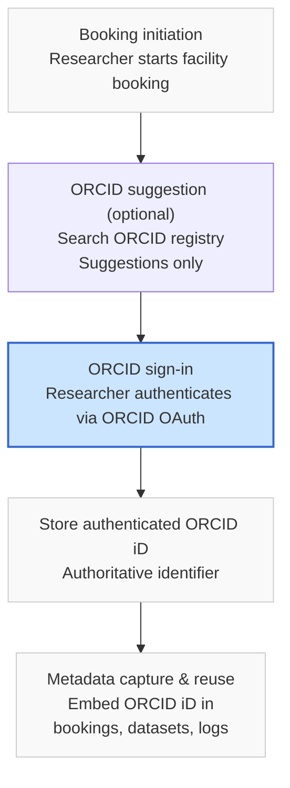

## Workflow for ORCID authentication:


***



***

### 

*   **ORCID search** is explicitly marked *optional* and non‑authoritative
*   **ORCID sign‑in** is visually emphasised as the **trust boundary**
*   Only **authenticated ORCID iDs** flow into stored metadata

This mirrors ORCID’s intended use *and* supports APPN’s heterogeneous workflows.

***

If you want next, I can:

*   Add a **field‑operations branch** (no booking → later metadata capture)
*   Produce a **sequence diagram** version
*   Annotate with **“allowed / not allowed” governance rules**
*   Align labels with **APPN schema classes** (Agent, Person, Creator)

Just tell me which variant you want.


## Obtaining a verified ORCID from a user.

To search ORCID you need a client_id

You get your **`client_id` by registering an application in ORCID’s Developer Tools**. It is **not auto‑generated** and does **not exist until you register**.


### TL;DR

**You get your `client_id` by registering your application in ORCID Developer Tools after logging into an ORCID account and verifying your email.**  
There is no other way to obtain one. [\[info.orcid.org\]](https://info.orcid.org/documentation/api-tutorials/api-tutorial-read-data-on-a-record/)

***


### Where your `client_id` comes from

#### ✅ It is issued by ORCID when you register an application

#### ✅ It is tied to **your ORCID account**

#### ✅ It is required for **all API use** (search, read, sign‑in)

ORCID provides this via the **Public API** (free) or **Member API** (for ORCID members). [\[info.orcid.org\]](https://info.orcid.org/documentation/api-tutorials/api-tutorial-read-data-on-a-record/)

***

### Step‑by‑step: get an ORCID `client_id`

#### 1️. Create (or sign in to) an ORCID record

You must have a personal ORCID account.

*   ORCID account required before accessing Developer Tools [\[info.orcid.org\]](https://info.orcid.org/documentation/api-tutorials/api-tutorial-read-data-on-a-record/)

***

#### 2. Verify your email address

ORCID **blocks Developer Tools access** until your email is verified.

*   This is mandatory [\[info.orcid.org\]](https://info.orcid.org/documentation/api-tutorials/api-tutorial-read-data-on-a-record/)

***

#### 3️.Open ORCID Developer Tools

Once signed in:

1.  Click your name (top‑right)
2.  Select **Developer Tools**
3.  Agree to the **ORCID Public API Terms of Service**
4.  Click **Register for ORCID Public API credentials**

 [\[info.orcid.org\]](https://info.orcid.org/documentation/api-tutorials/api-tutorial-read-data-on-a-record/)

***

#### Register an application

You’ll be prompted to enter:

| Field            | What to enter                           |
| ---------------- | --------------------------------------- |
| Application name | Your system or service name             |
| Application URL  | Public page for your project            |
| Description      | How you’ll use ORCID                    |
| Redirect URIs    | Required for OAuth sign‑in (HTTPS only) |

After saving, ORCID immediately generates:

*   ✅ **Client ID**
*   ✅ **Client secret**

 [\[info.orcid.org\]](https://info.orcid.org/documentation/api-tutorials/api-tutorial-read-data-on-a-record/)

***

#### 5️. Copy your credentials

In Developer Tools you will now see:

    Client ID:     APP-XXXXXXXXXXXX
    Client Secret: XXXXXXXXXXXXXXXXXXXXXXXXX

✅ Use these in your OAuth `curl` requests  
❌ Never commit the secret to source control

***

### Which environment should I register in?

#### Sandbox (recommended for testing)

*   Developer Tools → **Sandbox**
*   OAuth endpoint: `https://sandbox.orcid.org/oauth/token`
*   API base:`https://api.sandbox.orcid.org`

 [\[info.orcid.org\]](https://info.orcid.org/documentation/api-tutorials/api-tutorial-read-data-on-a-record/)

#### Production (when ready)

*   Developer Tools → **Production**
*   OAuth endpoint: `https://orcid.org/oauth/token`
*   API base:`https://api.orcid.org`

 [\[info.orcid.org\]](https://info.orcid.org/documentation/api-tutorials/api-tutorial-read-data-on-a-record/)

***

### Common misunderstandings (important)

| Misunderstanding                        | Reality                      |
| --------------------------------------- | ---------------------------- |
| “ORCID gives me one automatically”      | ❌ You must register          |
| “I can reuse someone else’s client\_id” | ❌ Not allowed                |
| “Search doesn’t need OAuth”             | ❌ OAuth required             |
| “client\_id identifies a user”          | ❌ It identifies **your app** |

 [\[info.orcid.org\]](https://info.orcid.org/documentation/api-tutorials/api-tutorial-read-data-on-a-record/), [\[info.orcid.org\]](https://info.orcid.org/documentation/api-tutorials/)

***

### How this fits your workflow

*   ✅ **ORCID search** → needs `client_id` + `client_secret`
*   ✅ **ORCID sign‑in** → same `client_id`, different OAuth flow
*   ✅ Works for booking + metadata capture
*   ✅ Aligns with ORCID governance guidance


***
`curl` example** showing how to perform an **ORCID registry search** using the **Public API**, followed by a brief explanation of each part.

This matches ORCID’s official API documentation and search tutorial. [\[info.orcid.org\]
***


## 1️. ORCID search — basic `curl` example

### Search by researcher name and affiliation

```bash
curl -X GET "https://api.orcid.org/v3.0/search/?q=family-name:Smith+AND+affiliation-org-name:\"University of Queensland\"" \
  -H "Accept: application/vnd.orcid+json" \
  -H "Authorization: Bearer YOUR_ACCESS_TOKEN"
```

 [\[info.orcid.org\]](https://info.orcid.org/documentation/api-tutorials/)

***

## 2️. What each part does

### Endpoint

    https://api.orcid.org/v3.0/search/

*   `v3.0` = current stable ORCID API schema
*   `/search/` = registry search endpoint 

***

### Query (`q=`)

Uses **SOLR syntax**, e.g.:

```text
family-name:Smith AND affiliation-org-name:"University of Queensland"
```

Common searchable fields include:

*   `given-names`
*   `family-name`
*   `affiliation-org-name`
*   `orcid`

 [\[info.orcid.org\]](https://info.orcid.org/documentation/api-tutorials/), [\[uao365-my....epoint.com\]

***

### Headers

```bash
-H "Accept: application/vnd.orcid+json"
-H "Authorization: Bearer YOUR_ACCESS_TOKEN"
```

*   `Accept` controls format (JSON or XML)
*   `Authorization` **is required** even for public search
*   Token must have `/read-public` scope [\[info.orcid.org\]](https://info.orcid.org/documentation/api-tutorials/api-tutorial-read-data-on-a-record/), [\[info.orcid.org\]](https://info.orcid.org/documentation/api-tutorials/)

***

## 3️⃣ Example: simple name‑only search

```bash
curl -X GET "https://api.orcid.org/v3.0/search/?q=given-names:James+AND+family-name:Kelly" \
  -H "Accept: application/vnd.orcid+json" \
  -H "Authorization: Bearer YOUR_ACCESS_TOKEN"
```

 [\[info.orcid.org\]](https://info.orcid.org/documentation/api-tutorials/)

***

## 4️⃣ Example response (trimmed)

```json
{
  "result": [
    {
      "orcid-identifier": {
        "path": "0000-0002-1825-0097",
        "uri": "https://orcid.org/0000-0002-1825-0097"
      }
    }
  ],
  "num-found": 1
}
```

⚠️ **Important:**  
Search results return **ORCID iDs only** — no names, no affiliations.  
You must make a **second call** to retrieve record details. [\[info.orcid.org\]](https://info.orcid.org/documentation/api-tutorials/)

***

## 5️⃣ Follow‑up: retrieve public record data

```bash
curl -X GET "https://api.orcid.org/v3.0/0000-0002-1825-0097/person" \
  -H "Accept: application/vnd.orcid+json"
```

 [\[info.orcid.org\]](https://info.orcid.org/documentation/api-tutorials/api-tutorial-searching-the-orcid-registry/)

***

## 6️⃣ Authentication reminder (critical)

To run the above searches you must:

1.  Register for **ORCID Public API credentials**
2.  Obtain a `/read-public` access token using **two‑legged OAuth**

ORCID explicitly discourages assigning ORCID iDs based on search alone — use **authenticated ORCID sign‑in** when storing identifiers. [\[info.orcid.org\]](https://info.orcid.org/documentation/api-tutorials/), [\[uao365-my....epoint.com\]
***

## ✅ When to use this in practice

*   Discovery
*   Analytics
*   “Is this you?” suggestion hints

## ❌ When *not* to use it

*   Assigning ORCID iDs automatically
*   Treating search results as authoritative identity

***


Below is a **correct, copy‑paste `curl` example** for obtaining an **ORCID OAuth access token** using the **Public API (two‑legged OAuth)**.  
This is the **required first step** before making ORCID **search** API calls. [\[info.orcid.org\]](https://info.orcid.org/documentation/api-tutorials/api-tutorial-read-data-on-a-record/), [\[info.orcid.org\]](https://info.orcid.org/documentation/api-tutorials/)

***

## ORCID OAuth token request (`curl`)

### ✅ Public API — `read-public` token (two‑legged OAuth)

```bash
curl -X POST "https://orcid.org/oauth/token" \
  -H "Accept: application/json" \
  -d "client_id=YOUR_CLIENT_ID" \
  -d "client_secret=YOUR_CLIENT_SECRET" \
  -d "grant_type=client_credentials" \
  -d "scope=/read-public"
```

 [\[info.orcid.org\]](https://info.orcid.org/documentation/api-tutorials/api-tutorial-read-data-on-a-record/), [\[info.orcid.org\]](https://info.orcid.org/documentation/api-tutorials/)

***

## What this request does

### Endpoint

    https://orcid.org/oauth/token

*   Production ORCID OAuth endpoint
*   No user interaction required (machine‑to‑machine) [\[info.orcid.org\]](https://info.orcid.org/documentation/api-tutorials/api-tutorial-read-data-on-a-record/)

***

### Parameters

| Parameter       | Meaning                                 |
| --------------- | --------------------------------------- |
| `client_id`     | Your ORCID Public API client ID         |
| `client_secret` | Your client secret                      |
| `grant_type`    | `client_credentials` (two‑legged OAuth) |
| `scope`         | `/read-public` (required for search)    |

 [\[info.orcid.org\]](https://info.orcid.org/documentation/api-tutorials/api-tutorial-read-data-on-a-record/), [\[info.orcid.org\]](https://info.orcid.org/documentation/api-tutorials/)

***

## Example response (trimmed)

```json
{
  "access_token": "eyJhbGciOiJSUzI1NiIsInR5cCI6IkpXVCJ9...",
  "token_type": "bearer",
  "expires_in": 631138518,
  "scope": "/read-public"
}
```

✅ Save the `access_token`  
✅ Use it in the `Authorization: Bearer` header when calling`/search/`

 [\[info.orcid.org\]](https://info.orcid.org/documentation/api-tutorials/)

***

## Sandbox (test environment)

To test safely, use the **sandbox endpoints**:

```bash
curl -X POST "https://sandbox.orcid.org/oauth/token" \
  -H "Accept: application/json" \
  -d "client_id=YOUR_SANDBOX_CLIENT_ID" \
  -d "client_secret=YOUR_SANDBOX_CLIENT_SECRET" \
  -d "grant_type=client_credentials" \
  -d "scope=/read-public"
```

 [\[info.orcid.org\]](https://info.orcid.org/documentation/api-tutorials/api-tutorial-read-data-on-a-record/)

***

## Using the token (example)

```bash
curl -X GET "https://api.orcid.org/v3.0/search/?q=family-name:Smith" \
  -H "Accept: application/vnd.orcid+json" \
  -H "Authorization: Bearer YOUR_ACCESS_TOKEN"
```

 [\[info.orcid.org\]](https://info.orcid.org/documentation/api-tutorials/)

***

## Important reminders (governance‑critical)

*   ✅ Public API search **requires OAuth**, even for public data
*   ✅ Token is **machine‑level**, not user‑level
*   ❌ This token **does NOT authenticate a researcher**
*   ✅ Authenticated **ORCID sign‑in (3‑legged OAuth)** is still required when storing ORCID iDs

ORCID explicitly discourages assigning ORCID iDs based on search alone. [\[info.orcid.org\]]
(https://info.orcid.org/documentation/api-tutorials/), [\[uao365-my....epoint.com\]
***


Just let me know which one you want.


